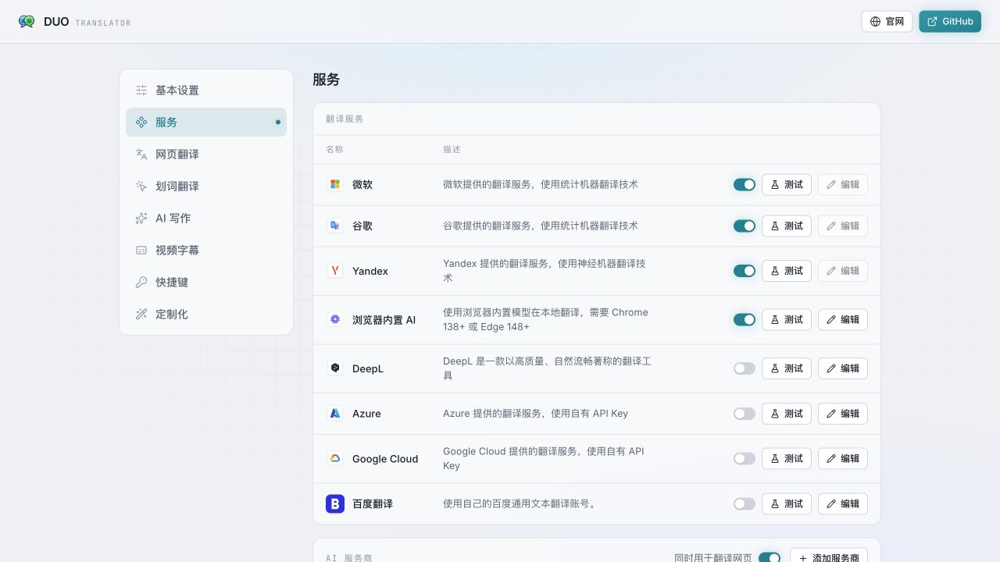
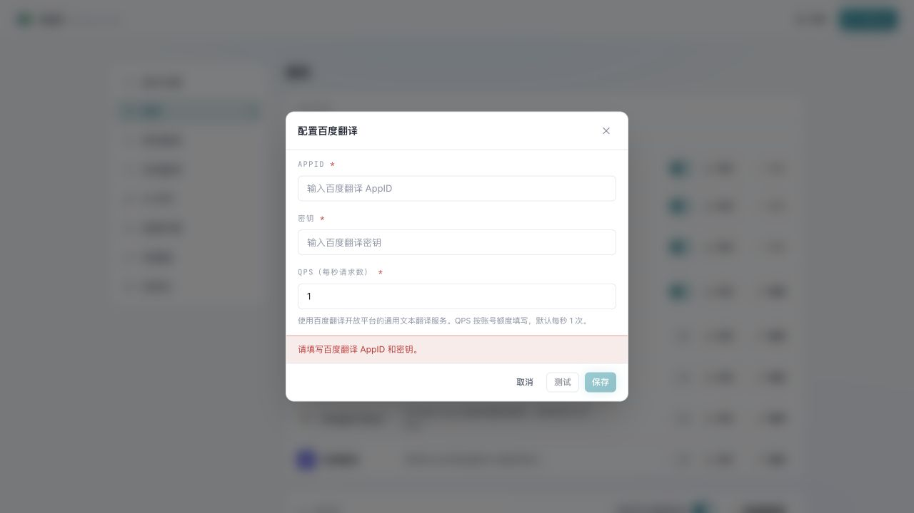
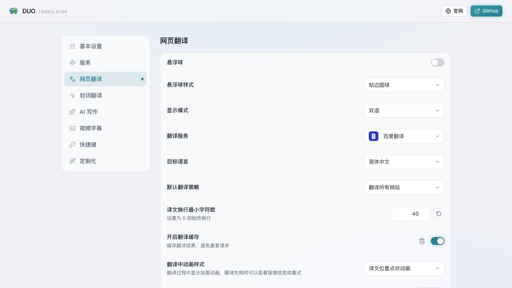

# Duo Translator · 百度翻译版

基于 [linuxscreen/duo-translator](https://github.com/linuxscreen/duo-translator) **v2.2.6** 的二次开发版本，新增百度「通用文本翻译 API」，使用自己的 APPID 和密钥。

保留上游网页双语、划词、输入框和视频字幕等功能。本仓库维护百度接入，问题请提交到[本仓库 Issues](https://github.com/sspu-wyl/duo-translator-baidu/issues)。

[下载安装包](https://github.com/sspu-wyl/duo-translator-baidu/releases) · [百度接入说明](docs/BAIDU.md) · [上游中文说明](README_zh.md)

## 这版增加了什么

- 在「翻译服务」中添加百度翻译，可填写 APPID、密钥和 QPS，保存前可测试连接。
- 百度请求集中在扩展后台，支持排队限速、长文本拆分和停止翻译。
- 网页翻译保留链接、强调等行内标签；百度未保留标签时，改为逐个文本片段翻译。
- 接入网页、划词、输入框、翻译工作台和字幕的翻译通道。语法纠正、润色和字幕 AI 分句仍使用原有 AI 服务。
- 百度密钥默认不进入配置备份和同步；源码与安装包不附带个人凭据。

## 安装与配置

1. 在 [Releases](https://github.com/sspu-wyl/duo-translator-baidu/releases) 下载名称含 `baidu`、`chrome` 的 ZIP，解压到固定目录。
2. Chrome 打开 `chrome://extensions/`，开启「开发者模式」，点击「加载已解压的扩展程序」，选择含 `manifest.json` 的目录。Edge 对应地址是 `edge://extensions/`。
3. 打开扩展设置 →「翻译服务」，找到「百度翻译」，点击编辑按钮。
4. 填写百度翻译开放平台的 **APPID、密钥**。QPS 默认 `1`，按账户实际额度调整。点击「测试」，通过后保存并开启百度服务。
5. 在「网页翻译」中把服务选为「百度翻译」。划词、输入框等入口可跟随网页设置，也可单独选择。

本仓库的版本需要手动加载，扩展商店中的上游正式版不包含这里的修改。加载时浏览器会显示扩展需要的权限。

## 界面截图

以下是本版本构建产物的设置界面，截图在本地预览中拍摄，未填写真实凭据。

**翻译服务列表**：新增百度翻译，初始关闭。



**百度配置**：APPID、密钥和 QPS 分别填写；密钥输入框遮挡显示，必填项未填时不能保存。



**选择网页翻译服务**：配置并开启后，可在网页翻译设置中选择百度。



## 使用边界与密钥

- 对接的是百度翻译开放平台「通用文本翻译 API（APPID＋密钥）」。其他百度产品的 AK/SK、领域翻译、大模型接口不能直接填入。
- 密钥保存在浏览器扩展的 `storage.local`，属于本机明文配置。输入框遮挡和默认不导出不等于加密；主动勾选「包含 API 密钥」后，密钥会进入相应备份或同步数据。
- 连接测试、翻译语种检测、标签回退也会请求百度 API。费用和额度以自己的百度账户为准，具体语言范围和限速说明见 [百度接入说明](docs/BAIDU.md)。
- 构建模板中的 Google API Key 和 OAuth Client ID 留空。如需 Google Cloud 翻译或 Google Drive 同步，需自行配置对应服务；本仓库不提供上游的内置凭据。

## 本地开发

需要 Node.js 22 和 pnpm 11。

```sh
git clone https://github.com/sspu-wyl/duo-translator-baidu.git
cd duo-translator-baidu
cp .env.example .env
pnpm install --frozen-lockfile
pnpm dev
```

开发构建从 `.output/chrome-mv3-dev` 加载。`.env` 仅用于本地构建参数；百度 APPID/密钥在扩展设置中填写，不写进源码。

```sh
pnpm i18n:check
pnpm compile
pnpm test
pnpm build                 # .output/chrome-mv3
pnpm build:firefox         # .output/firefox-mv3，未签名
pnpm zip                  # Chrome ZIP
pnpm e2e:build
pnpm e2e:no-real
```

后续同步上游：

```sh
git remote add upstream https://github.com/linuxscreen/duo-translator.git
git fetch upstream
git merge upstream/master
```

合并后处理冲突并重新测试、构建。开发约定见 [CONTRIBUTING.md](CONTRIBUTING.md)，本分支修改记录见 [CHANGELOG.md](CHANGELOG.md)。

## 来源与许可证

原项目由 [linuxscreen](https://github.com/linuxscreen) 和上游贡献者开发，感谢其开源工作。本仓库保留上游提交历史和 [GPL-3.0 许可证](LICENSE)，百度接入修改沿用同一许可证。本版本由本仓库独立维护。
